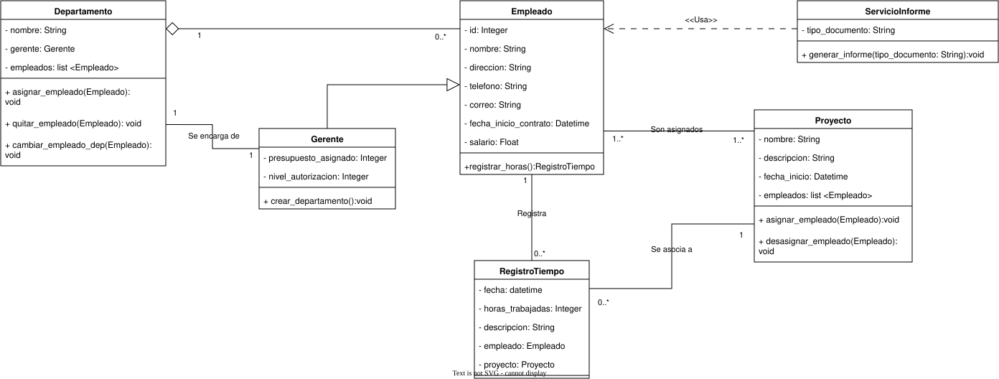

# Sistema de gestión de recursos humanos "Jurel Inc."  ⟩<^,«⋗

Este repositorio contiene el codigo fuente para el sistema de recursos humanos de la empresa *"Jurel Inc."* junto con el script para levantar la base de datos a traves de MySql Workbench.
Se ha dejado deliberadamente las credenciales para poder probar el sistema pero se recomienda cambiarlas

## Dependencias

Para este proyecto necesitamos de:

- Python 3
- MySql workbench o en su defecto Oracle

Librerias utilizadas:

- dotenv
- mysql-connector-python

## Funciones

Las principales funciones de este programa son las de manejar la organización de los empleados, sus departamentos y gerentes a cargo de ellos.

Además podemos ingresar tanto registros de tiempo de cada empleado como nominas de proyectos en los cuales estan actualmente trabajando.

Todo esto se respalda en una base de datos SQL la cual debe ser configurada con las credenciales correcta en el archivo [.env](.env) para poder funcionar.

### UML del sistema

